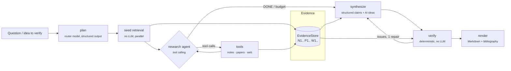

# Architecture

Implemented with LangGraph (`src/scholar_agent/agent/graph.py`). One `RunContext` per question carries the
evidence store, the budget guard, the token tracker and the outbound-privacy guard.

## Modules

| Package | Responsibility |
|---|---|
| `ingestion/` | `Loader` protocol + registry (`.md` Obsidian, `.txt`), heading-aware chunker with exact line ranges, incremental pipeline (content hash) |
| `indexing/` | `Embedder` protocol (Ollama / fastembed / hash), Qdrant hybrid store (dense + hashed-BM25 sparse with IDF), SQLite catalog (notes, wikilink graph, diagnostics), optional cross-encoder reranker |
| `retrieval/` | hybrid search → rerank → MMR diversity → 1-hop wikilink expansion |
| `tools/` | agent tools (`search_notes`, `get_note`, `follow_links`, `search_papers`, `get_paper_details`, `web_search`, `fetch_url`), literature providers (OpenAlex, Europe PMC, Semantic Scholar, arXiv), web search/fetch |
| `citations/` | `EvidenceStore` (stable IDs), verifier/pruner, DOI check (Crossref → DataCite), Markdown formatter |
| `budget/` | pricing, per-query `QueryTracker` (LangChain callback), persistent `Ledger`, `BudgetGuard` |
| `privacy/` | `OutboundGuard` (blocks private-note text in external queries) |
| `evaluation/` | metrics, datasets, five suites, reports |

## Design decisions

* **Citations are structural, not prompted.** The synthesizer can only cite IDs that exist in the
  `EvidenceStore`, each with a verbatim quote that is string-matched against the evidence text. Claims that
  fail are removed from the answer (after one repair attempt). A hallucinated reference cannot reach the
  output; a DOI is additionally checked against Crossref/DataCite.
* **Modes are enforced by tool registration**, not by instructions: in `notes` mode the external tools do
  not exist for the model (`tools/registry.py`), so `external_calls == 0` is guaranteed and tested.
* **The agent's own ideas are a separate output field** (`ai_ideas`, rendered as `[IA-n]` with the evidence
  that inspired them) and never mix with sourced claims.
* **Personal notes are typed.** `HIP —` notes are marked "your hypothesis" in the bibliography, so the
  answer never presents your speculation as established fact.
* **Hashed BM25 sparse vectors** keep lexical search language-agnostic (ES/EN notes) and dependency-free;
  Qdrant applies IDF at query time and fuses with the dense ranking by RRF.
* **Everything pluggable is a `Protocol` + registry**: new note formats, embedders, vector stores,
  literature providers and LLM providers are one file plus one config line.
* Qdrant runs in local on-disk mode by default; point `QdrantStore(url=...)` at a server to scale.

## Scaling to thousands of notes

Ingestion is incremental by content hash (re-running over 3000 notes only processes changes), embeds in
batches, and tolerates unreadable files (reported, not fatal). `research doctor` reports empty/duplicate
notes, orphans and broken wikilinks without any LLM call, which helps with disorganised collections.
